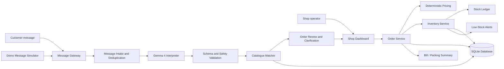
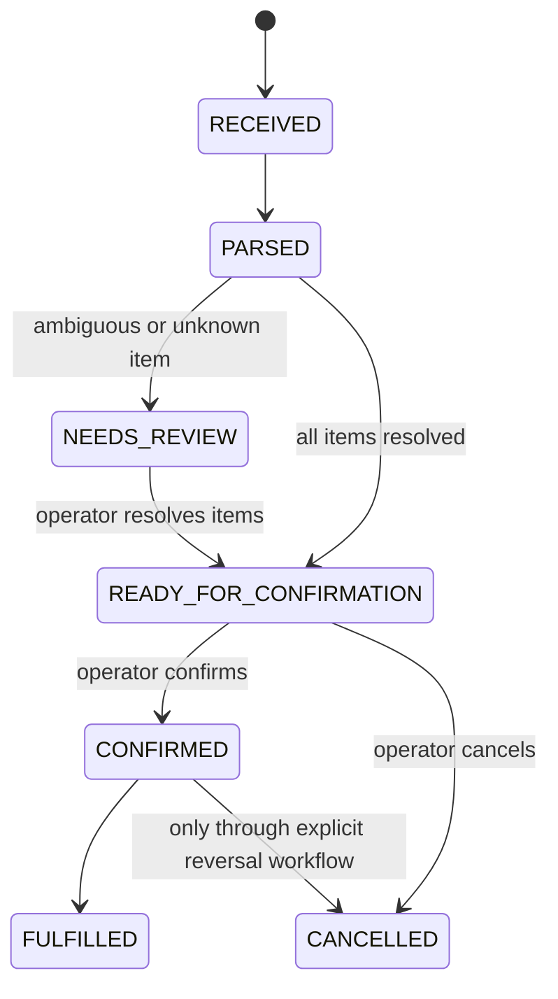
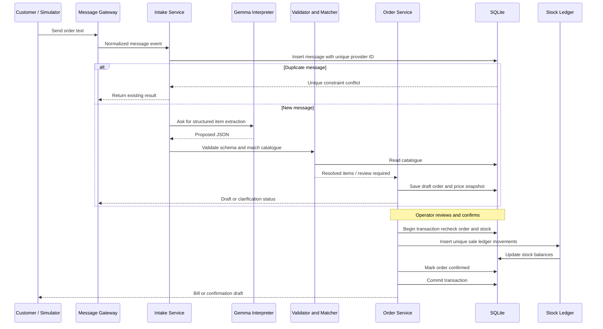

# BhashaOps — Architecture Design Document

**Project:** BhashaOps  
**Tagline:** From Conversations to Verified Actions  
**Document type:** Architecture Design Document (ADD)  
**Status:** Hackathon MVP design  
**Primary use case:** Convert informal Malayalam, Manglish, and English kirana-store order messages into reviewable orders and reliable stock updates.

---

## 1. Purpose

BhashaOps helps a neighbourhood shop turn conversational messages into structured, verifiable business actions. Gemma 4 interprets the customer's wording; deterministic application logic validates the result, resolves catalogue products, calculates totals, and updates stock only after an order is confirmed.

The MVP prioritizes one complete, demonstrable workflow:

1. Receive or simulate a customer message.
2. Interpret it with Gemma 4.
3. Match mentioned items to the shop catalogue.
4. Ask for clarification when product, unit, or pack size is ambiguous.
5. Show a reviewable order with prices calculated by application code.
6. Confirm the order and generate a bill/packing summary.
7. Deduct stock exactly once and record the stock ledger entry.
8. Flag low stock.

Chat2Ops (turning group conversations into tasks and decisions) is an optional extension, not a dependency of the core workflow.

## 2. Goals and Non-Goals

### Goals

- Support informal Malayalam, Manglish, English, and mixed-language order messages.
- Make model output structured and schema-validated.
- Keep product identity, prices, totals, and stock decisions under deterministic application control.
- Require human review for uncertain matches and order confirmation before stock changes.
- Prevent duplicate message processing and duplicate stock deduction.
- Provide a simple interface for orders, catalogue, and stock alerts.
- Run locally for a controlled demo where practical.
- Make the WhatsApp integration replaceable by a simulator or an approved provider integration.

### Non-Goals for the hackathon MVP

- Fully autonomous purchasing or supplier payments.
- Automatic stock increases from unverified supplier messages.
- Unsupervised sending of every customer reply.
- Full accounting, tax, multi-branch inventory, or enterprise permissions.
- Guaranteed support for every Malayalam dialect or spelling.
- Production-grade WhatsApp integration using an unofficial client.
- Chat2Ops unless the order-to-stock workflow is already reliable.

## 3. Architecture Principles

1. **Gemma interprets; code decides.** The model extracts intent and item mentions. Application code owns catalogue matching, pricing, validation, inventory, and state transitions.
2. **Untrusted model output.** Parse and validate every model response. Reject malformed output and never execute instructions embedded in a customer message.
3. **Review uncertainty.** Unknown products, ambiguous pack sizes, low-confidence matches, and unavailable stock require clarification or manual review.
4. **Confirmation gates side effects.** No stock deduction before an order is confirmed.
5. **Idempotent operations.** Reprocessing the same message or confirmation must not create duplicate orders or ledger entries.
6. **Auditable inventory.** Stock changes are represented as ledger transactions, not silent edits.
7. **Graceful fallback.** If Gemma or WhatsApp integration fails, allow a manual order or a simulated message.
8. **Privacy by design.** Use synthetic demo data, avoid logging unnecessary personal data, and do not commit session files or secrets.

## 4. High-Level System Context



**Important boundary:** A WhatsApp gateway transports messages; it does not decide whether an order is valid. The dashboard/operator approves uncertain items and confirms the final order.

## 5. Logical Components

### 5.1 Message Gateway

**Responsibility**
- Receive inbound messages from the chosen adapter.
- Normalize them into a common internal event.
- Attach provider message ID, sender identifier, received time, and source.
- Forward the event to the intake service.

**Adapters**
- `SimulatorAdapter` — required fallback for a reliable demo.
- `WhatsAppWebAdapter` — optional hackathon adapter using `whatsapp-web.js`.
- A future approved WhatsApp Business Platform adapter can implement the same interface.

**Normalized event example**

```json
{
  "source": "simulator",
  "external_message_id": "demo-msg-0001",
  "conversation_id": "demo-customer-01",
  "sender_id": "customer-demo-01",
  "text": "chetta 2 kilo atta, 1 amul butter cheruth, 6 ande",
  "received_at": "2026-10-25T09:00:00+05:30"
}
```

Treat sender and message identifiers as provider-scoped; do not assume they are globally unique.

### 5.2 Message Intake and Deduplication

**Responsibility**
- Validate required event fields and message length.
- Persist the inbound message before processing.
- Enforce a unique constraint on `(source, external_message_id)`.
- Return the existing processing result when a duplicate arrives.
- Track status such as `RECEIVED`, `PROCESSING`, `PROCESSED`, `NEEDS_REVIEW`, or `FAILED`.

Use a database transaction to create the inbound-message record. A duplicate-key conflict should be handled as an idempotent no-op, not as a new order.

### 5.3 Gemma 4 Interpreter

**Responsibility**
- Identify likely intent, language, and product mentions.
- Extract quantity, unit, variant, pack-size hints, and the original text span.
- Identify ambiguity and propose a short clarification question.
- Return JSON matching a versioned schema.

**Suggested model contract**

```json
{
  "schema_version": "1.0",
  "intent": "PLACE_ORDER",
  "language": "ml-en-mixed",
  "items": [
    {
      "product_mention": "atta",
      "quantity": 2,
      "unit": "kg",
      "variant": null,
      "pack_size_hint": null,
      "source_text": "2 kilo atta",
      "needs_review": false,
      "clarification_question": null
    },
    {
      "product_mention": "amul butter cheruth",
      "quantity": 1,
      "unit": "piece",
      "variant": "small",
      "pack_size_hint": null,
      "source_text": "1 amul butter cheruth",
      "needs_review": true,
      "clarification_question": "Which small Amul butter pack do you mean?"
    }
  ],
  "general_notes": []
}
```

This example illustrates the output shape, not a claim that the model will always interpret the text correctly. Validate every field and test the exact model build used in the demo.

**Model rules**
- Do not ask the model to set prices, calculate totals, change stock, or mark an order confirmed.
- Do not treat the model response as executable instructions.
- Use low-temperature/deterministic settings when available.
- Apply a timeout and bounded retry policy.
- If the response is invalid or unavailable, place the message in manual review.

### 5.4 Schema and Safety Validation

Validate:
- JSON parses successfully.
- `schema_version` is supported.
- `intent` is an allowed enum.
- Quantities are numeric, positive, finite, and within a reasonable configured maximum.
- Units belong to an allow-list.
- Item count and text lengths are bounded.
- Required fields exist and unexpected fields are ignored or rejected according to the schema policy.
- Any ambiguity is preserved for the operator rather than silently discarded.

Use a schema library such as Pydantic in the Python backend.

### 5.5 Catalogue Matcher

**Responsibility**
- Match product mentions against canonical product names and aliases.
- Resolve brand, variant, unit, and pack-size hints.
- Return candidate products and a match status.
- Never silently choose among materially different products.

**Match outcomes**
- `EXACT` — unique and compatible match.
- `CANDIDATES` — multiple plausible products; request clarification.
- `UNKNOWN` — no safe match.
- `INCOMPATIBLE_UNIT` — the mention and catalogue unit cannot be reconciled.

A simple MVP can use normalized aliases and token similarity. Keep the matching implementation replaceable. Model-generated product names are suggestions, not catalogue IDs.

### 5.6 Order Review and Order Service

**Order lifecycle**



**Rules**
- Persist the parsed interpretation and the resolved catalogue product IDs.
- Calculate line totals and grand total using application code and catalogue prices.
- Revalidate stock availability at confirmation time.
- Store a price snapshot on the order item so later catalogue price changes do not rewrite historical bills.
- Only allow legal state transitions.
- A cancellation after confirmation must create an explicit reversal/return transaction where appropriate; do not delete the original stock ledger entry.

### 5.7 Pricing and Bill Generation

Pricing is deterministic:

- Resolve catalogue product ID.
- Convert requested quantity to the catalogue's supported base unit, where conversion is explicitly configured.
- Calculate line totals and grand total using decimal arithmetic or integer paise.
- Apply only configured discounts or taxes.
- Store the price snapshot and totals on the order.
- Generate a printable bill or packing summary.

Never use a language model's numerical total as the source of truth. If quantity conversion is unclear, require review.

### 5.8 Inventory Service and Stock Ledger

**Responsibility**
- Read current stock.
- Recheck availability when confirming an order.
- Create exactly one stock movement for each confirmed order item.
- Record low-stock events.
- Process supplier receipts only after the operator verifies that goods were received.

**Inventory invariant**

> For a given confirmed order, each stock deduction is applied at most once.

Enforce this with a unique idempotency key, for example `order:<order_id>:item:<order_item_id>:sale`, on the stock ledger. In one database transaction:
1. Verify the order is eligible for confirmation.
2. Revalidate stock.
3. Insert the unique stock-ledger entry.
4. Update the materialized stock quantity (if one is maintained).
5. Mark the order confirmed.
6. Commit all changes together.

If any step fails, roll back the entire transaction. SQLite transaction behavior and write locking should be tested; keep the transaction short.

**Stock movement types**
- `SALE` — confirmed order deduction.
- `RECEIPT` — operator-confirmed supplier receipt.
- `ADJUSTMENT` — explicit correction with reason.
- `RETURN` — verified returned goods.
- `REVERSAL` — correction of an earlier movement, linked to the original.

Never increase stock merely because a supplier was messaged or an AI proposed a receipt.

### 5.9 Low-Stock Alerts

Trigger when available stock is at or below the product's configured threshold. The MVP may compute this after a stock movement or during dashboard refresh. Avoid creating repeated duplicate alerts for the same unchanged condition; either upsert the current alert state or record a transition from “not low” to “low.”

### 5.10 Dashboard

Minimum screens:
- **Inbox:** recent messages, processing status, duplicate/error state.
- **Order Review:** interpreted items, matched product, quantity, unit, price, ambiguity, and confirmation/cancel controls.
- **Orders:** lifecycle status, bill, timestamps.
- **Catalogue:** product name, aliases, unit, pack size, price, stock, threshold.
- **Inventory:** current quantities, ledger history, low-stock alerts.
- **Demo Mode:** submit a sample message without connecting WhatsApp.

Make uncertain matches visually obvious and require an explicit operator decision.

### 5.11 Optional Chat2Ops Extension

Only begin after the order-to-stock workflow is complete and tested.

It can extract:
- Candidate tasks and owners.
- Deadlines and date uncertainty.
- Budgets and numeric constraints.
- Decisions, unresolved questions, and dependencies.

Store source message, extracted proposal, confidence/review state, and edit history. Treat owner and date extraction as suggestions. Do not silently overwrite a task or convert “Friday” into a date without a known message timestamp and timezone.

## 6. Proposed Technology Stack

| Layer | MVP choice | Notes |
|---|---|---|
| Backend | Python + FastAPI | Typed request/response models |
| Validation | Pydantic | Validate model output and API payloads |
| Database | SQLite | Adequate for a local single-shop demo |
| AI | Gemma 4 through a verified local runtime such as Ollama | Verify exact model tag, runtime support, hardware fit, and response latency before the demo |
| Messaging | Simulator first; optional `whatsapp-web.js` adapter | Unofficial WhatsApp Web automation has compatibility and account risks |
| Frontend | HTML/CSS/JavaScript or existing project frontend | Keep dashboard scope small |
| Bill | HTML print stylesheet or generated PDF | Prefer the simplest reliable output |
| Tests | pytest + API/integration tests | Include duplicate and rollback cases |

The exact Gemma 4 model identifier and runtime compatibility must be verified on the actual machine; do not hard-code an unverified model name into setup documentation.

## 7. Data Model

The following is a logical schema; adapt field types and naming to the implementation.

### `inbound_messages`
- `id` — primary key
- `source`
- `external_message_id`
- `conversation_id`
- `sender_id` — minimize or pseudonymize when practical
- `message_text`
- `received_at`
- `status`
- `error_code` / `error_summary`
- Unique constraint: `(source, external_message_id)`

### `interpretations`
- `id`
- `inbound_message_id` — foreign key
- `schema_version`
- `model_identifier`
- `raw_json` — bounded and retained only as needed
- `validated_json`
- `created_at`

### `products`
- `id`
- `sku`
- `name`
- `brand`
- `variant`
- `pack_size`
- `base_unit`
- `unit_price_minor` — integer in the smallest currency unit (for INR, paise)
- `stock_quantity`
- `low_stock_threshold`
- `active`

### `product_aliases`
- `id`
- `product_id`
- `alias_normalized`
- Unique constraint on the chosen normalization scope

### `orders`
- `id`
- `inbound_message_id`
- `status`
- `currency`
- `subtotal_minor`
- `discount_minor`
- `total_minor`
- `confirmed_by`
- `confirmed_at`
- `created_at`
- `updated_at`

### `order_items`
- `id`
- `order_id`
- `product_id`
- `requested_quantity`
- `requested_unit`
- `base_quantity`
- `unit_price_minor_snapshot`
- `line_total_minor`
- `resolution_status`
- `source_text`

### `stock_ledger`
- `id`
- `product_id`
- `movement_type`
- `quantity_delta`
- `reference_type`
- `reference_id`
- `idempotency_key` — unique
- `reason`
- `created_by`
- `created_at`

### Optional `tasks` (Chat2Ops)
- `id`
- `title`
- `owner_candidate`
- `due_at`
- `due_date_text`
- `budget_minor`
- `status`
- `source_message_id`
- `review_status`
- `created_at`
- `updated_at`

**Design note:** If `stock_quantity` is stored on `products`, treat it as a materialized current balance and update it in the same transaction as the ledger. Periodically or in tests, reconcile it against ledger movements and opening stock. For a larger system, consider deriving balances from the ledger or adding a formal reconciliation process.

## 8. API Design

Illustrative REST endpoints; exact paths can change during implementation.

| Method | Endpoint | Purpose |
|---|---|---|
| `POST` | `/api/messages` | Ingest a normalized message event |
| `GET` | `/api/messages` | List inbox messages and statuses |
| `GET` | `/api/messages/{id}` | View message and interpretation |
| `POST` | `/api/messages/{id}/interpret` | Retry interpretation or trigger manual review |
| `GET` | `/api/products` | List/search catalogue |
| `POST` | `/api/products` | Create a catalogue product |
| `PATCH` | `/api/products/{id}` | Update allowed catalogue fields |
| `GET` | `/api/orders` | List orders |
| `GET` | `/api/orders/{id}` | View order and bill data |
| `POST` | `/api/orders/{id}/resolve` | Resolve ambiguous items |
| `POST` | `/api/orders/{id}/confirm` | Confirm order and atomically deduct stock |
| `POST` | `/api/orders/{id}/cancel` | Cancel according to lifecycle rules |
| `GET` | `/api/inventory` | Read stock and low-stock state |
| `GET` | `/api/inventory/ledger` | Read stock movement history |
| `POST` | `/api/inventory/receipts` | Record an operator-confirmed receipt |
| `GET` | `/api/health` | Health check |

For every mutating endpoint, validate input, enforce state transitions, and return stable error codes. In a multi-user or internet-exposed deployment, add authentication, authorization, rate limiting, CSRF protection where applicable, and audit logging before production use.

## 9. Core Sequence: Message to Confirmed Order



The actual message response should be sent only through a configured, authorized adapter. For the hackathon demo, displaying a reply draft in the dashboard is an acceptable fallback.

## 10. Error Handling and Recovery

| Failure | Expected behavior |
|---|---|
| Gemma runtime unavailable | Mark as `NEEDS_REVIEW` or `FAILED`; allow manual entry/retry |
| Model returns invalid JSON | Reject output; log a bounded error; do not create a confirmed order |
| Unknown or ambiguous item | Ask for clarification or require operator resolution |
| Product out of stock | Prevent confirmation or allow an explicit partial-order workflow if implemented |
| Duplicate inbound message | Return existing processing state; do not create a second order |
| Duplicate confirmation request | Return existing confirmed order; do not deduct stock again |
| Stock changes before confirmation | Revalidate inside the confirmation transaction |
| Database write fails | Roll back the confirmation and all associated stock movements |
| WhatsApp adapter fails | Use simulator/manual inbox; core order workflow remains available |
| Supplier receipt uncertain | Keep as a proposal; do not change stock until verified |

## 11. Security, Privacy, and Trust

- Store runtime secrets in environment variables or a local secret mechanism; commit only `.env.example`.
- Exclude `.env`, WhatsApp authentication/session directories, database files with real customer data, logs containing sensitive content, and generated customer documents from Git.
- Use synthetic names, phone numbers, and order messages in public demos and tests.
- Keep message text only as long as the product needs it; avoid printing full messages in routine logs.
- Sanitize rendered message text to prevent HTML/script injection.
- Do not expose the local dashboard or model service to the public internet without authentication and network controls.
- Restrict inventory mutations to authorized operators.
- Treat all inbound text and model output as untrusted data.
- Keep an audit trail for confirmation, cancellation, stock adjustment, and receipt verification.
- Be precise about “local-first”: local inference does not mean WhatsApp transport is local. WhatsApp messages still pass through WhatsApp infrastructure.
- `whatsapp-web.js` is an unofficial integration and may break or carry account risk. Use a dedicated test account if permitted, and prefer the official WhatsApp Business Platform for a production deployment.

## 12. Testing Strategy and Acceptance Criteria

### Unit tests
- Malayalam/Manglish/English text normalization.
- Schema validation and invalid model output.
- Alias matching and ambiguous product candidates.
- Quantity/unit conversion rules.
- Integer-paise pricing.
- Order state transition validation.
- Low-stock threshold behavior.

### Integration tests
- Simulator message creates one draft order.
- Unknown product results in review rather than silent selection.
- Operator resolves ambiguity and confirms order.
- Confirmation writes one ledger movement per order item.
- Repeated inbound message creates no duplicate order.
- Repeated confirmation creates no duplicate deduction.
- Stock change between draft and confirmation is detected.
- Failed transaction leaves neither a partial deduction nor a confirmed order.
- Supplier receipt proposal does not change stock until verified.

### Multilingual demo cases
- `chetta 2 kilo atta, 1 amul butter cheruth, 6 ande`
- A Malayalam-script order with at least two catalogue products.
- Mixed English and Manglish with spelling variation.
- An unknown brand or ambiguous pack size.
- An out-of-stock item.
- A correction or cancellation request.

### Demo acceptance criteria
- A visitor can submit a sample message without WhatsApp credentials.
- The app shows the extracted items and resolved catalogue matches.
- The operator can inspect or resolve ambiguous items.
- Prices and totals are computed by code.
- Confirmation updates stock exactly once.
- The stock ledger explains the change.
- A low-stock warning appears when the configured threshold is crossed.
- The README explains how to start the demo and what is simulated.

Report measured results from the actual test set; do not claim an accuracy percentage without measurement.

## 13. Deployment and Runtime

**Hackathon deployment recommendation**
- Run the FastAPI service, SQLite database, and local model runtime on one development machine.
- Start with the simulator and confirm the complete workflow before connecting WhatsApp.
- Check model availability and response latency early.
- Provide a small seeded catalogue and reset script so the demo can be repeated.
- Include a health endpoint and clear startup logs.
- Keep all local session data out of source control.

Potential startup order:
1. Start and verify the local model runtime.
2. Pull/select the verified Gemma 4 model build.
3. Install Python dependencies and configure environment.
4. Initialize SQLite and seed demo products.
5. Start FastAPI.
6. Open the dashboard and run the scripted demo.
7. Start the messaging adapter only if it has been tested and is safe to use.

## 14. Four-Hour Implementation Priorities

### Must-have
1. Shared product/order schema.
2. Simulator input and message deduplication.
3. Gemma extraction with validation and manual fallback.
4. Catalogue matching and ambiguity review.
5. Deterministic bill calculation.
6. Confirmed-order transaction with idempotent stock ledger.
7. One clear dashboard and scripted end-to-end demo.

### Should-have
- Malayalam/Manglish alias improvements.
- Low-stock dashboard.
- Printable bill or packing slip.
- Clear error/review states and seed/reset script.

### Stretch only
- Live WhatsApp connection.
- Automated customer reply delivery.
- UPI QR generation.
- Supplier receipt proposals.
- Chat2Ops task extraction and history.

**Cut scope, not integrity:** If time runs short, use the simulator and skip Chat2Ops or live WhatsApp. Do not skip order review, deterministic pricing, or idempotent stock handling.

## 15. Known Risks and Mitigations

| Risk | Mitigation |
|---|---|
| Gemma model/runtime not ready | Verify at the start; build simulator and manual fallback first |
| Slow inference | Keep prompts short, use a small seeded catalogue, display processing status |
| Malayalam spelling variation | Use alias dictionaries and clarification flow; test real examples |
| Ambiguous product pack sizes | Require operator resolution |
| Duplicate events or clicks | Database unique constraints and idempotency keys |
| Partial inventory update | Single database transaction with rollback tests |
| WhatsApp connection instability | Simulator adapter with identical event contract |
| Scope creep | Treat Chat2Ops and automation as stretch features |
| Overstated AI claims | Show actual examples and report measured tests only |

## 16. Future Extensions

- Official WhatsApp Business Platform integration.
- More robust Malayalam and Manglish evaluation corpus.
- Supplier catalogue and purchase-order workflows.
- Multi-user authentication and role-based access.
- Audit exports and inventory reconciliation.
- Order status messages with explicit operator approval.
- Multi-shop tenancy and database migration to PostgreSQL.
- Chat2Ops tasks with reviewable owners, deadlines, dependencies, and change history.
- Offline queueing and observability for a production deployment.

## 17. Decisions to Keep Explicit

- The model extracts intent; deterministic code owns business decisions.
- Product IDs always come from the catalogue, never directly from model output.
- A draft order does not affect stock.
- Only confirmed orders create sale movements.
- Each sale movement has a unique idempotency key.
- Supplier messages are not proof of received stock.
- The simulator is a first-class fallback, not a throwaway demo.
- Chat2Ops is postponed until the core order workflow passes end-to-end tests.

---

**One-line architecture summary:** BhashaOps uses Gemma 4 to understand multilingual conversational intent, then routes the proposal through deterministic catalogue matching, human review, code-based pricing, and transactional inventory operations so that business actions are verifiable and safe.
